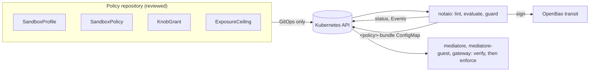

# Concepts

notaio turns reviewed policy objects into signed bundles that every enforcement point in a sandbox
can verify on its own. These pages explain the pieces, from the smallest up.

| Page | What it explains |
| --- | --- |
| [Knobs and steps](knobs.md) | The unit of policy: 34 knobs from the threat model, each with steps `R0` to `R3` |
| [SandboxProfile](profiles.md) | A named set of knob steps: Fortress, Hardened, Standard, Lab |
| [SandboxPolicy](policies.md) | Who may claim a sandbox, under which profile, with which audiences, egress and tools |
| [KnobGrant](grants.md) | A time-boxed, approved relaxation of one knob for one policy |
| [ExposureCeiling](ceilings.md) | The approved maximum of what a policy may expose |
| [The bundle](bundle.md) | What notaio publishes, and how a consumer decides to trust it |
| [The life of a change](life-of-a-change.md) | One change, from pull request to enforcement, with every check on the way |

## The shape of it

Three ideas run through every page:

- **Policy is data, reviewed like code.** The four kinds arrive only through review and a GitOps
  reconciler (`deploy/admission/gitops-only.yaml`). notaio itself can read them and write their
  status, nothing else.
- **Everything narrows.** A profile sets the loosest each knob may be; a policy can only narrow
  it; a grant loosens one knob by one step, for a bounded time, with named approvals; a ceiling
  caps the whole result.
- **Consumers trust signatures, not paths.** A bundle is trusted because it verifies against a
  public key and is newer than the last one accepted, never because of where it was read.
