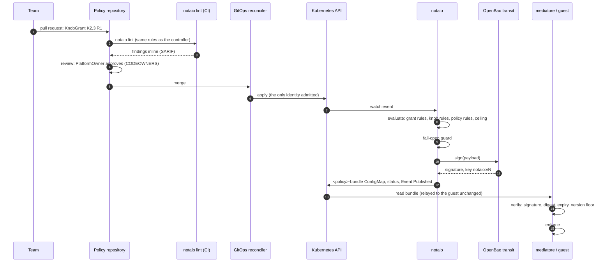

# The life of a change

One change, a team asking for package installation on its policy, followed from pull request to
enforcement. Every gate it passes is listed, with what enforces it.

## The gates

| # | Gate | Enforced by | If it fails |
| --- | --- | --- | --- |
| 1 | The change is linted with the controller's own rules, ceilings included | `notaio lint` in the policy repository's CI ([ADR-0006](../adr/0006-notaio-lint-cli.md)) | the pull request shows the finding and its code |
| 2 | The roles the knob names approve | review and CODEOWNERS; the approval is recorded in the grant (`L013`) | not merged, or rejected by the controller |
| 3 | Only the GitOps identity may change the four kinds | `deploy/admission/gitops-only.yaml`, a ValidatingAdmissionPolicy | the API server denies it, even for cluster-admin |
| 4 | The profile is valid; the grant is one step, in time, approved, and completes no toxic combination; the policy fits its effective knobs | `evaluate` in `sandboxpolicy-core` | `Ready=False` with the reason; the grant `Rejected` |
| 5 | The exposure, grant included, is within the approved ceiling | `lint_exposure` (`L014` to `L016`) | `Ready=False, ExposureAboveCeiling`; nothing published |
| 6 | The bundle passes an independent re-check | the fail-open guard ([ADR-0010](../adr/0010-health-metrics-and-events.md)) | `Ready=False, FailOpenRefused`; `notaio_fail_open_total` rises |
| 7 | OpenBao signs | the transit key, the `notaio-sign` policy | `Ready=False, SigningFailed`; the previous bundle stays |
| 8 | The consumer verifies before acting | `verify_bundle` and the version floor | the consumer refuses the bundle |

## When the grant lapses

Nobody acts. The bundle carrying the grant was issued with `notAfter` at the grant's expiry. At
that moment the controller reconciles, marks the grant `Expired`, records an Event, and publishes a
new bundle without it. A consumer that missed the new bundle refuses the old one anyway, because
it has expired.

## When something is tightened

A profile change, a policy change, a removed grant or a narrower ceiling all re-evaluate the policy.
If the result still publishes, the new bundle has a higher version, and consumers move to it at
their next read. If it no longer publishes, the last bundle stays valid only until its
`notAfter`, at most one bundle lifetime, and consumers refuse it after that. Tightening is therefore
bounded in time without any revocation mechanism.
